<p align="center">
  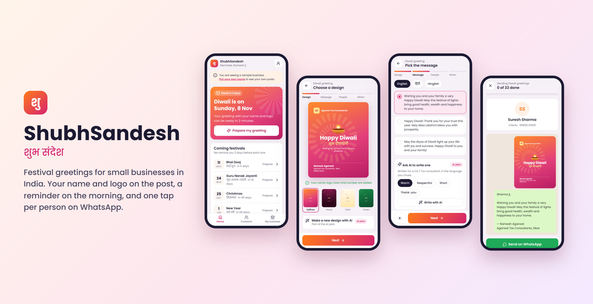
</p>

<h1 align="center">ShubhSandesh · शुभ संदेश</h1>

<p align="center">
  <b>Festival greetings for Indian small businesses, ready before you are.</b><br>
  Your name and logo on the post. A reminder on the festival morning. One tap per person on WhatsApp.
</p>

<p align="center">
  <a href="https://raghav1000000000.github.io/shubhsandesh/prototype/"><b>▶ Try the live demo</b></a> ·
  <a href="https://raghav1000000000.github.io/shubhsandesh/marketing/trailer/">Watch the trailer</a> ·
  <a href="marketing/pamphlet/ShubhSandesh-pamphlet-A5.pdf">Pamphlet</a>
</p>

<p align="center">
  
  
  
  
</p>

---

## The problem

Every festival morning, a CA in Sikar, a lawyer in Bhilwara or a salon owner in Hisar does the same thing:

1. Searches Google for a Diwali image.
2. Asks the children (or ChatGPT, or Canva) to add the firm name and logo.
3. Sends it **one by one** to 200 to 300 clients, partners and relatives.
4. Spends two or three hours on it, and still forgets someone important.

They are comfortable with WhatsApp and little else. Existing tools are either too complex or need a WhatsApp Business API setup they will never do.

## The idea

ShubhSandesh does the boring parts and leaves the person in control.

| Step | What the app does | What the user does |
|---|---|---|
| **Remind** | Notifies 2 days before each festival | Nothing |
| **Design** | Makes a post with their name, logo, town and number | Picks one of the designs |
| **Message** | Offers ready messages in English, Hindi and Hinglish; AI can write one for their profession | Picks or edits |
| **People** | Keeps their contact list in groups | Ticks who should get it |
| **When** | Reminds them on the festival morning at the time they choose | Picks a time |
| **Send** | Opens each person's WhatsApp chat with the message ready | Taps **Send**, about 4 seconds per person |

280 greetings take about **20 minutes instead of 2 to 3 hours**, from their own WhatsApp, with no ban risk.

## Try the prototype

**Live demo: https://raghav1000000000.github.io/shubhsandesh/prototype/** (open it on your phone)

The clickable prototype is a single HTML file with sample data. It needs no build step. To run it locally:

```bash
# from the repo root
npx serve prototype
# or just open prototype/index.html in a browser
```

Best viewed at phone width (open dev tools and pick a phone, or open it on your phone). The demo date is fixed to **Fri 6 Nov 2026**, two days before Diwali.

### Screens

| Home | Design | Message | People |
|:-:|:-:|:-:|:-:|
| 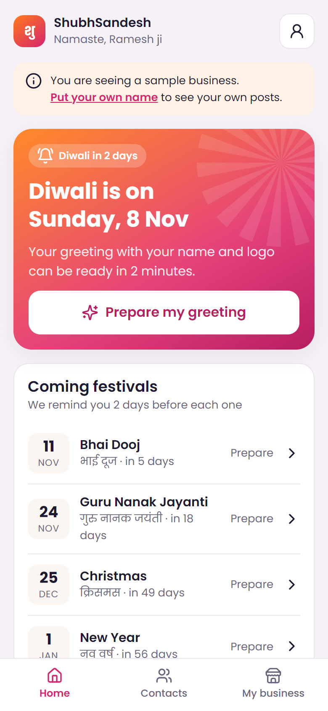 | 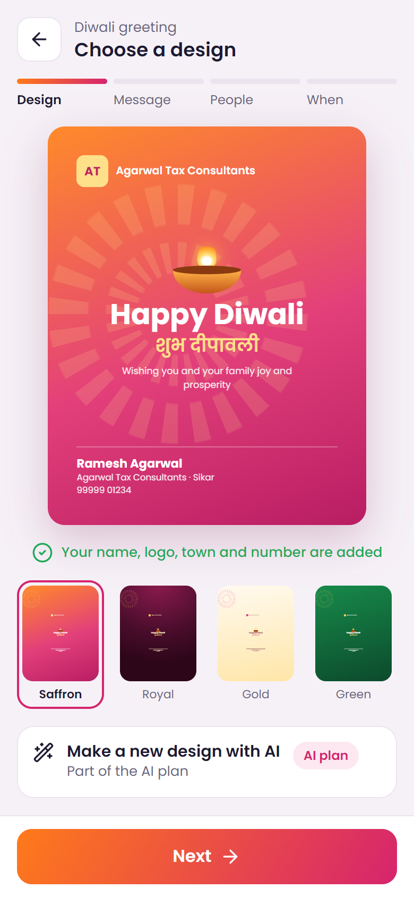 | 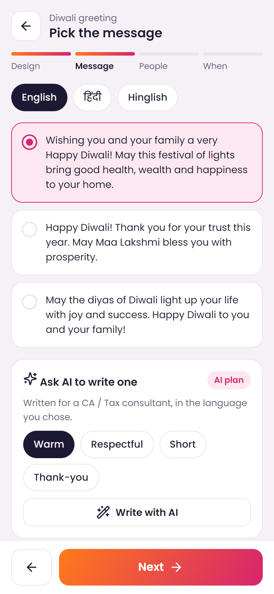 | 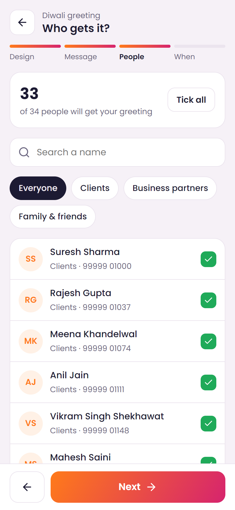 |
| **When** | **Reminder set** | **Sending** | **Done** |
| 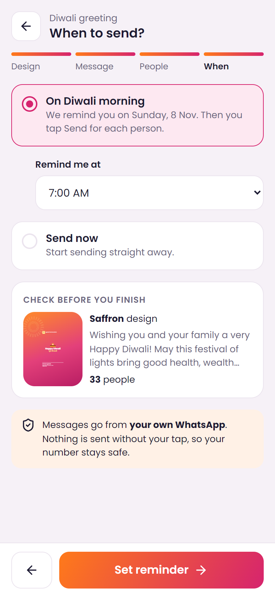 | 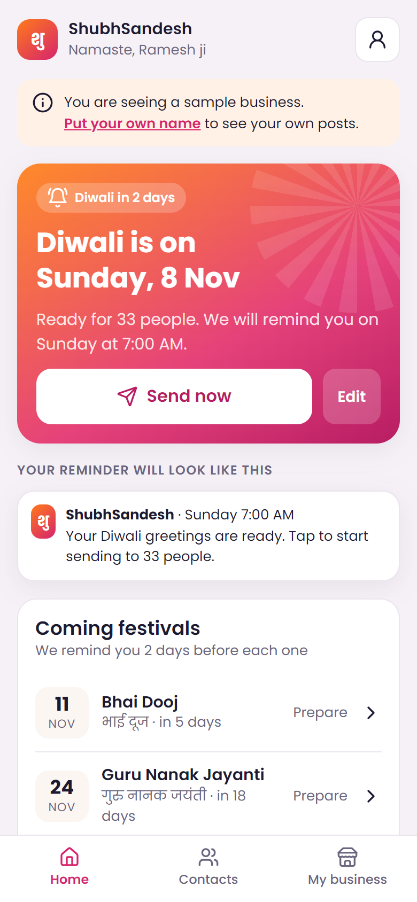 | 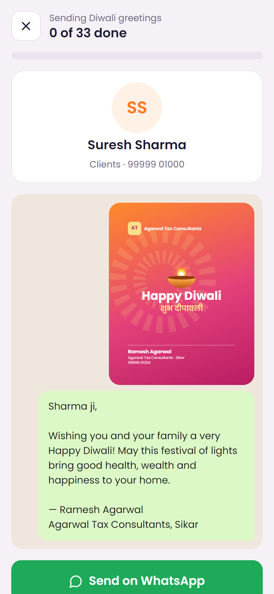 | 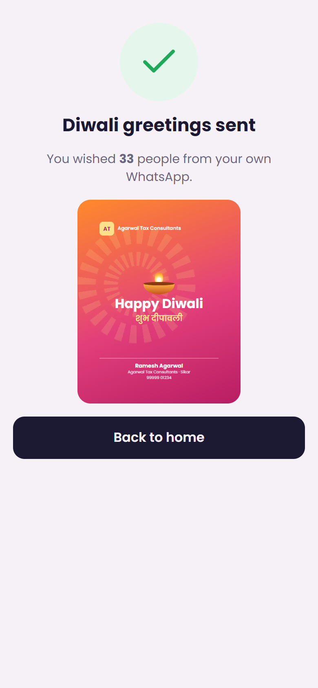 |

## Plans

| | **Regular** | **AI** |
|---|---|---|
| Price | **₹999 / year** | **₹1,999 / year** |
| Per day | under ₹3 | under ₹6 |
| Festival reminders | ✓ | ✓ |
| Designs with name and logo | ✓ | ✓ |
| Ready messages (EN / हिंदी / Hinglish) | ✓ | ✓ |
| Send from own WhatsApp | ✓ | ✓ |
| AI-written messages for their profession | | ✓ |
| New AI designs | | up to 20 per festival |

Prices include 18% GST. See [docs/pricing.md](docs/pricing.md) for the profit check.

## Marketing material

| Trailer (92 s) | Review pamphlet (A5) |
|:-:|:-:|
| <a href="marketing/trailer/ShubhSandesh-trailer.mp4">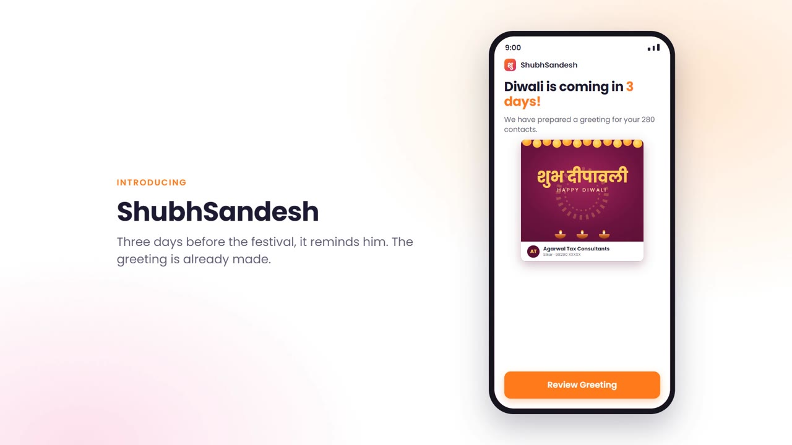</a> | <a href="marketing/pamphlet/ShubhSandesh-pamphlet-A5.pdf">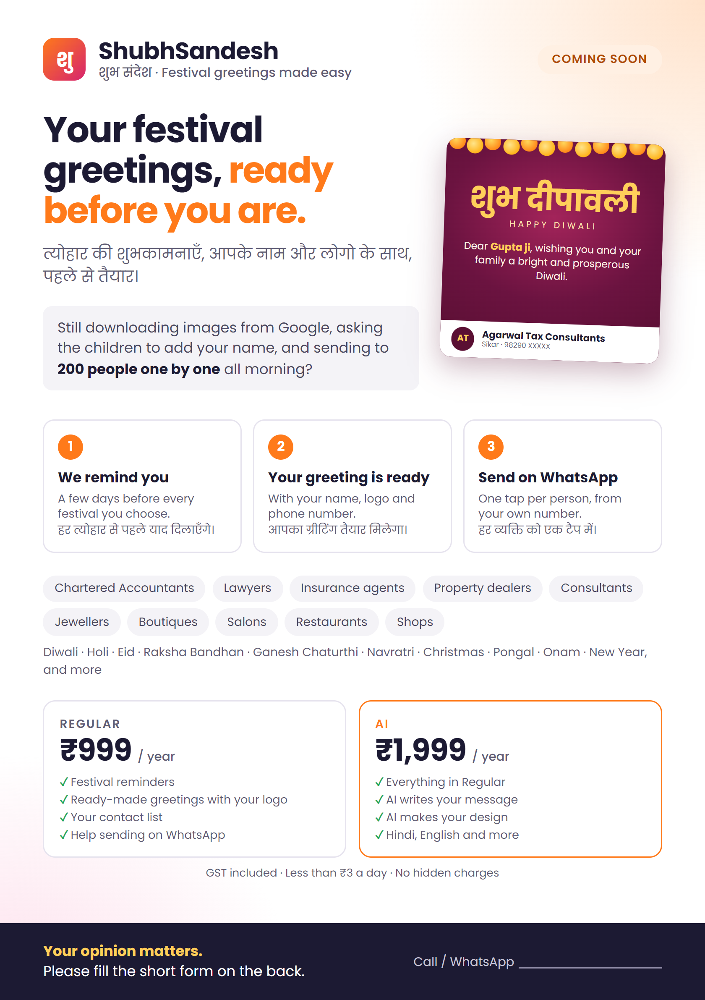</a> |
| [Landscape MP4](marketing/trailer/ShubhSandesh-trailer.mp4) · [Vertical MP4 for WhatsApp Status](marketing/trailer/ShubhSandesh-trailer-vertical.mp4) · [HTML source](marketing/trailer/index.html) | [Print PDF](marketing/pamphlet/ShubhSandesh-pamphlet-A5.pdf) · [Front](marketing/pamphlet/ShubhSandesh-pamphlet-front.png) · [Back (feedback form)](marketing/pamphlet/ShubhSandesh-pamphlet-back.png) |

The pamphlet's back page is a bilingual feedback form for real customers: how they send greetings today, how many contacts, whether one tap per person is acceptable, and what price feels right.

## Repository layout

```
prototype/          Clickable mobile prototype (single HTML file, sample data)
marketing/
  trailer/          Animated trailer: HTML source + rendered MP4s
  pamphlet/         A5 pamphlet with customer feedback form: HTML, PDF, PNGs
docs/               Product brief, WhatsApp and contacts approach, pricing, roadmap
assets/             README images and prototype screenshots
tools/              Node scripts that render the trailer to MP4 and the pamphlet to PDF
```

## Docs

- [Product brief](docs/product-brief.md): who it is for, principles, the user journey
- [WhatsApp and contacts](docs/whatsapp-and-contacts.md): how contacts are imported and how sending works, with limits
- [Pricing and GST](docs/pricing.md): plans, GST, profit per customer
- [Roadmap](docs/roadmap.md): what comes next

## Status

This is an early **prototype for customer feedback**. It is not a production app: there is no backend, login or payment, and changes are stored only in the viewer's browser. "ShubhSandesh" is a working name.

---

<p align="center">Made in India, for the people who still send every greeting by hand. 🪔</p>
